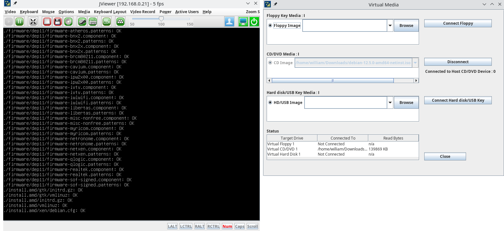
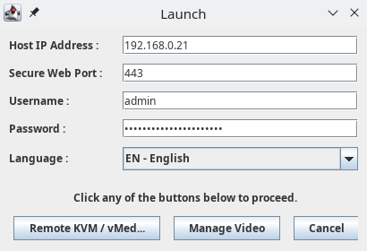

# JViewer (AMI MegaRAC KVM) for modern OpenJDK

Runs the AMI MegaRAC JViewer KVM client, which BMCs serve as a Java Web Start app, on a modern OpenJDK on Linux,
macOS or Windows (tested on OpenJDK 25+ on Linux, Apple Silicon macOS and Windows 10, against an ASRock EPC612D4I BMC with
firmware 07.12.00).

This repository contains no AMI code. The client is downloaded from your own BMC and patched locally:
the patches are applied to the bytecode by pattern rather than at fixed offsets, so other JViewer versions
(other boards and firmware) should work too, although only 07.12.00 has been tested.



## Requirements
- A JDK, 24 or newer (OpenJDK 25+ tested). It must be a full JDK, not a JRE, and not a headless build.
- On Linux, an X11 or XWayland session

That's all: the tooling is a single Java program, [tools/JViewerPatcher.java](tools/JViewerPatcher.java), run from
source by the `run`/`build` scripts. They warn about anything missing, with an install hint, but carry on anyway
(`JVIEWER_SKIP_CHECKS=1` silences them).

## Getting started
1. In the BMC web UI, open the remote console and save the `jviewer.jnlp` it offers.
2. First run: fetch this BMC's JViewer, patch it and launch it with the session from the JNLP:
   ```bash
   ./run.sh ~/Downloads/jviewer.jnlp
   ```
3. Later runs: standalone, logging in with your BMC username and password (no JNLP needed):
   ```bash
   ./run.sh <bmc-host>
   ```

On Windows, use `run.cmd` instead of `./run.sh` (and `build.cmd` instead of `./build.sh`), e.g.
`run.cmd "%USERPROFILE%\Downloads\jviewer.jnlp"` and then `run.cmd <bmc-host>`.



## First launch (JNLP)
Open the remote console from the BMC web UI as usual and save the `jviewer.jnlp` it offers instead of opening
it with Java Web Start, then `./run.sh jviewer.jnlp` (a `https://…/jviewer.jnlp` URL works too, if the BMC serves it
without a login cookie). The tool:
- downloads the `<jar>` resources from the JNLP's codebase into `cache/jars/<host_port>/` (refreshed on every
  JNLP launch; `<nativelib>` jars are skipped, they are not needed). The BMC certificate is not verified, as in JViewer.
- hands the `application-desc` main class and arguments (which include a one-time session token) and any
  `<property>` values to the JViewer JVM it starts (`java -cp … <main> <args>`). The arguments are not written to disk.

The jars are merged into one patched `JViewer.jar` under `cache/build/<hash>/`, rebuilt only when the BMC's jars
or the patches change (old builds can be deleted with `rm -rf cache/build`). The JNLP is usually only valid for one
launch, so download a fresh one each time you use this mode.

## Standalone launches
The tool remembers which build belongs to the JNLP's codebase host (`cache/hosts/<host>`), so afterwards
`./run.sh <host>` opens JViewer's own login dialog (username/password instead of a session token) with that
BMC's jars. Use the same host name or IP as in the JNLP's codebase; with no host, the last one is used.
The web port defaults to 443 (`PORT=… ./run.sh <host>`). `./run.sh -- <args…>` passes raw JViewer arguments.

To use jars obtained some other way (e.g. from a firmware image's `Java/release/` directory):
`./build.sh -o out path/to/jars/` and then `JVIEWER_JAR=out/JViewer.jar ./run.sh <host>`.

## Options
Environment variables (on Windows, `set NAME=value` before `run.cmd`):
- `TLS_PROTOCOLS=TLSv1.2,TLSv1`: if a newer BMC no longer accepts TLS 1.0 (the default is TLSv1 only).
- `JVIEWER_JAVA_OPTS="-Dsun.java2d.uiScale=2"`: extra options for the JViewer JVM (this one helps a tiny HiDPI window).
- `JVIEWER_DEBUG=1`: build with JViewer's console logging enabled (cached separately).
- `JAVA=/path/to/java`: which Java runs the tool; JViewer is started with the same one.
- `JVIEWER_DRY_RUN=1`: print the java command instead of launching (JViewer's arguments are only counted, since
  they can contain the session token or password).

The build prints what it patched and warns when it finds nothing to patch or a `native` method it has no
replacement for (that feature then fails with `UnsatisfiedLinkError`; add a method to `VMediaNatives`).

## Fixes
| Problem on modern Java | Fix |
|---|---|
| Startup crash in `getSupportedLocales` (`ArrayList.get(-1)` now throws `IndexOutOfBoundsException`) | bytecode: every `catch (ArrayIndexOutOfBoundsException)` widened to `IndexOutOfBoundsException` |
| Fallback login sets `https.protocols=SSLv3` (removed from JDK) → "Connection Failure" | bytecode: `SSLv3` dropped from protocol-list string constants (→ `TLSv1`) |
| BMC speaks only TLS 1.0 / `TLS_RSA_WITH_AES_256_CBC_SHA`, 1024-bit SHA-1 cert | `legacy.java.security` + TLSv1-only flags in `run.sh` (`TLS_PROTOCOLS` to change) |
| Native vmedia libs (x86 only, missing from jar in standalone mode) → `FloppyRedir` init crash killed the network listener (blank video) | replaced entirely by pure Java, see below |
| Reflection into `AWTEvent.bdata` blocked by module system | `--add-opens java.desktop/java.awt=ALL-UNNAMED` |
| Jar signatures invalid after patching | stripped; all jars merged into one `JViewer.jar` |

## Virtual media (pure Java)
The native `libjava{cdrom,floppy,harddisk}wrapper` libraries were reverse-engineered (the Linux builds have symbols)
and replaced by `patch-src/com/ami/iusb/ImageDisk.java`, a small SCSI block-device emulator over an image file.
The build gives every `native` method of `CDROMRedir`/`FloppyRedir`/`HarddiskRedir` a body that calls the
static method of the same name in `patch-src/com/ami/iusb/VMediaNatives.java` (with `this` as the first argument),
and points their native-library loading (`System.load`/`loadLibrary`, `getWrapperLibrary`) at no-ops there.
The rest of those classes is the original bytecode, so this only depends on the native method signatures.

IUSB SCSI packet: 32-byte IUSB header, ReadLen@32, TagNo@36, DataDir@40, 12-byte CDB@41,
status/sense@53..56, DataLen@57 (LE), data@61. Response = request's first 62 bytes + status + data.

- CD-ROM (2048-byte sectors, read-only): TEST UNIT READY, READ CAPACITY, READ(10/12), READ TOC (formats 0/1, LBA/MSF), START STOP, PREVENT ALLOW
- Floppy / hard disk (512-byte sectors, read/write, file-locked): the above minus TOC, plus WRITE(10), FORMAT UNIT, READ FORMAT CAPACITIES, MODE SENSE(6/10)

### Differences from the native libraries
Not implemented:
- **Physical drives.** The natives could redirect real CD/DVD drives, floppies, USB sticks and hard disks
  (Linux: `/dev` scan, device locking, SCSI passthrough; macOS: IOKit `IOCDMedia`/`IODVDMedia` and raw
  `/dev/diskN`). The drive lists are now always empty, so only image files can be redirected.
- **Keyboard-layout auto-detection.** The Linux native parsed `xprop -root _XKB_RULES_NAMES` (us/fr/de/es/jp);
  the macOS native returned a constant. Now always US; pick another layout from the *Keyboard Layout* menu.
- **Lock-key sync** (see Limitations).
- **FAT boot-sector safeguard.** When the remote machine wrote sector 0 of a floppy/HDD image, the natives
  preserved some BPB geometry fields (hidden sectors, sectors/track, heads, drive number) from the original.
  Writes are now stored exactly as sent.
- Version strings (`getVersion`) report `pure-java`. Internal native helpers that Java never called
  (create image from physical floppy, filesystem-type probe) were not ported.

Behaves slightly differently:
- READ range check covers `lba + count` (the native CD code only compared the sector count to the image size).
- "Medium changed" unit attention is reported once, on the first TEST UNIT READY or READ CAPACITY after
  connecting (the native floppy/HDD code returned it for whichever command came first).
- READ TOC also answers format 1 (session info), and the lead-out address honours the LBA/MSF bit.
- Writes to a read-only image return sense 07/27/00 (write protected); MODE SENSE sets the WP bit.
- An image file is opened read/write only for floppy/HDD and when writable, with an advisory file lock;
  otherwise it is redirected read-only (the client then shows "Device redirected in Read Only Mode").

Tested on a Linux host via the BMC: ISO mounted and read (virtual CD-ROM); a 64 MB MBR/FAT32 image and a
1.44 MB FAT12 floppy image mounted, read and written, with the writes landing in the image files.

## Linux
No native code, so any architecture works. Tested on Debian (X11) with KVM video and CD-ROM redirection. Notes:
- Needs a non-headless JDK (e.g. `openjdk-25-jdk`, not `-jre-headless`) and an X11/XWayland session.
- Fedora/RHEL system crypto policies are opted out of (`security.useSystemPropsFile=false`,
  `-Djava.security.disableSystemPropertiesFile=true`) so TLS 1.0 to the BMC stays allowed.
- HiDPI: `JVIEWER_JAVA_OPTS=-Dsun.java2d.uiScale=2 ./run.sh …` if the window is tiny.

## Windows
JViewer itself needs no native code any more, and `run.cmd`/`build.cmd` run the same Java tool as on Linux
and macOS. Tested on Windows 10 with the Microsoft Build of OpenJDK 25 (`winget install Microsoft.OpenJDK.25`):
JNLP launch with KVM video. Standalone login and virtual media are not yet tested there; virtual media works
with image files only, as elsewhere.

## Limitations
- Virtual media: image files only, no physical drives; keyboard layout defaults to US (see
  [Differences from the native libraries](#differences-from-the-native-libraries)).
- Disconnecting a virtual disk in JViewer while it is still mounted on the remote machine makes that kernel
  retry/reset the USB device until the BMC reports the medium removed; unmount first.
- Passing a password as `./run.sh host user pass` makes it visible to other local users (`ps`, Task Manager);
  prefer typing it in the dialog.
- Lock-key state is not synchronised. The original native code read the local Num/Caps/Scroll Lock state and
  toggled local keys (via `java.awt.Robot`) to match the remote machine's LEDs; that is now a no-op
  (`FloppyRedir.GetLEDStatus` echoes the remote state). Pressing a lock key still sends it to the remote machine,
  and the status bar's Num/Caps/Scroll indicators show the remote state, but if the two start out different they
  stay different until you press the key. (The macOS native version never worked anyway: it linked against a
  long-gone X11 path.)
